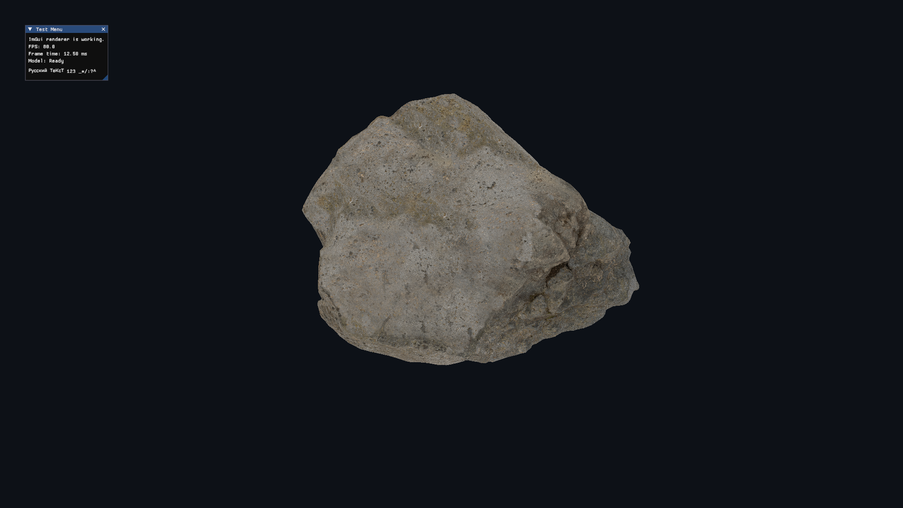

## `X-Player` Engine::
### - is a experemental open-source C++20 multithreaded game engine built on Vulkan 1.3 and SDL3 with asynchronous glTF loading, bindless textures

The current code includes a working model rendering demo.

| Development Stage |
| :--- |
| There’s a rock. It’s not an ordinary rock, but it’s not made of gold either; it’s loaded onto the GPU asynchronously via glTF, complete with textures and materials. It’s designed to simulate map streaming. Oh, and there’s also an ImGui rendere. |

Full engine specification is available here: [Docs/X-Player/Specification.md](/Docs/X-Player/Specification.md)

## Demo::



Demo screenshots gallery - [Docs/X-Player/ScreenshotsGallery.md](/Docs/X-Player/ScreenshotsGallery.md)

## How to build::

### Linux:

#### [0.] To begin working with the engine, you need to install all development dependencie:
```
./Scripts/Dev/XEnvPreparator.sh
```

#### 1. Next, to perform a build, needs to activate the development env for the engine and the products built upon it:
```
source ./Project/XEnv
```

#### 2. Building:
```
./Scripts/Building/XBuilder.sh -r
```

You can remove the -r (--run) argument to disable automatic execution after the build.

## Source rules::

| License |
| :--- |
| Apache License 2.0 |
